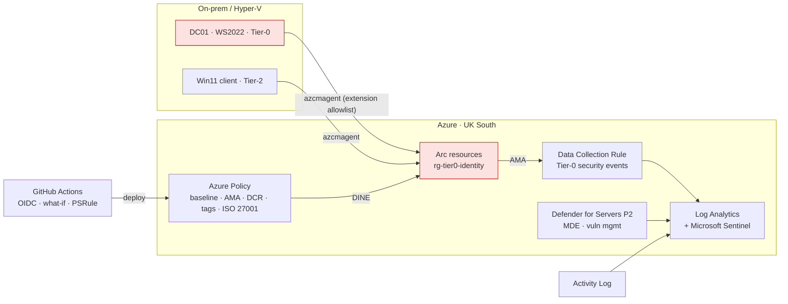

# Hybrid Tier-0 Security Baseline — Azure Arc, Defender for Cloud, Sentinel

Policy-as-code and IaC for bringing an on-premises AD domain controller under Azure
governance **without turning Azure into a path to Domain Admin**.

## Problem statement
Arc-enabling a domain controller extends the Azure control plane onto a Tier-0 asset.
Anyone with write access to the Arc resource can push an extension or Run Command that
executes as SYSTEM on the DC — i.e. domain compromise. Most "hybrid baseline" labs
ignore this. This project treats it as the primary risk and designs around it.

## Architecture


## Key design decisions (ADRs)
| # | Decision | Why |
|---|----------|-----|
| 01 | Azure Monitor Agent + DCRs, **not MMA** | The Log Analytics agent (MMA) was retired 31 Aug 2024. DCRs also give per-tier collection scope. |
| 02 | Arc agent locked with an **extension allowlist** (AMA + MDE only) | Blocks Custom Script / Run Command on Tier-0 even if Azure RBAC is misconfigured. Defence in depth. |
| 03 | Tier-0 servers in a dedicated RG; write access **only via PIM** | Arc resource write = SYSTEM on the DC. It must be governed like Domain Admin. |
| 04 | Everything deployed by Bicep from CI using **OIDC federation** | No stored secrets, reviewable diffs (what-if on PR), repeatable, drift-detectable. |
| 05 | Don't re-assign MCSB; add **ISO 27001** as a regulatory standard | MCSB is already Defender for Cloud's default initiative; duplicating it doubles noise. |
| 06 | **UK South** region | Data residency for identity telemetry. |
| 07 | Workspace daily cap in lab only | A cap on a SIEM silently drops security events. Production sets `dailyQuotaGb = -1`. |

Alternative considered: don't Arc-enable DCs at all, and cover them with Defender for
Identity + direct MDE onboarding. Valid for high-assurance environments; trade-off is
losing Azure Policy/Machine Configuration drift reporting on the DC.

## Threat model (Tier-0 focus)
| Threat | Control | Detection |
|--------|---------|-----------|
| Azure admin pushes code to DC via Arc | Extension allowlist, PIM, dedicated RG | `detections/rules/01` |
| DCSync from a compromised account | Tiered admin model | Rule 2 (4662 replication GUIDs) |
| Kerberoasting | AES-only service accounts / gMSA | Rule 3 (4769 RC4 burst) |
| Privileged group tampering | PIM for AD / change control | Rule 4 (4728/4732/4756) |
| Defence evasion — log clearing / agent tamper | MDE tamper protection | Rules 5 & 6 (1102, heartbeat loss) |
| Baseline drift on DC | Machine Configuration audit | Policy compliance + evidence script |

## Control mapping (ISO/IEC 27001:2022 Annex A)
A.5.15 Access control · A.8.2 Privileged access rights · A.8.8 Technical vulnerabilities ·
A.8.9 Configuration management · A.8.15 Logging · A.8.16 Monitoring activities.

## Repository layout
```
infra/                 Bicep: subscription deployment + modules
policies/              Custom policy (only where built-ins can't express Tier-0 scope)
scripts/               Hardened Arc onboarding, ARG compliance evidence, Sentinel rule deployer
detections/rules/      Sentinel analytics rules as YAML (MITRE + entity mapped)
tests/                 Pester: rule schema, script hygiene, policy + IaC guardrails
.github/workflows/     Test (Pester) → validate (lint, PSRule, policy-ID check, what-if) → gated deploy incl. rules
docs/                  Screenshots + evidence of validation
```

## Deploy
1. Create an Entra app with a federated credential for this repo; grant it Owner on the
   lab subscription (Owner is needed for policy role assignments — scope it tightly in prod).
2. Set repo variables `AZURE_CLIENT_ID`, `AZURE_TENANT_ID`, `AZURE_SUBSCRIPTION_ID`.
3. Open a PR → review the what-if output → merge → approve the `production` environment.
4. Onboard servers with `scripts/Onboard-ArcServer.ps1` using a certificate-based
   onboarding SP holding only *Azure Connected Machine Onboarding* on the Tier-0 RG.
5. Trigger remediation for DINE assignments:
   `az policy remediation create -n ama --policy-assignment pa-ama-arc-windows`
   (repeat for `pa-dcr-assoc-windows`, `pa-inherit-tier-tag`).

## Validation — proving the controls work
| MITRE | Simulation (isolated lab only) | Expected result | Evidence |
|-------|--------------------------------|-----------------|----------|
| T1003.006 | Atomic Red Team DCSync test | Rule 2 incident | `docs/` |
| T1558.003 | Kerberoast request burst | Rule 3 incident | `docs/` |
| T1098 | Add test user to Domain Admins | Rule 4 incident | `docs/` |
| T1070.001 | Clear Security log | Rule 5 incident + MDE alert | `docs/` |
| T1072 | Push Custom Script Extension to DC01 | **Blocked** by allowlist + Rule 1 incident | `docs/` |
| — | Stop AMA service | Rule 6 incident within 15 min | `docs/` |

## Cost and teardown
Main drivers: Defender for Servers P2 per server, Sentinel/LAW ingestion (event 4662 is
high-volume on DCs — tune the SACL). Teardown: delete both resource groups, remove policy
assignments, set Defender plans back to Free.

## What I'd change for production
Management-group scope instead of subscription, Arc Private Link Scope, Defender for
Identity sensors on every DC, Sentinel content deployed via Repositories, exemptions with
expiry dates, and workbook-based secure-score trending for leadership reporting.
